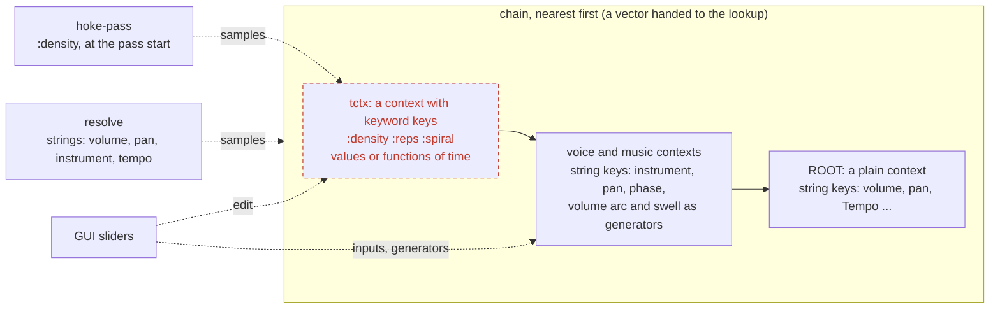

# A dynamic hoketus: call order and where the parts sit

A plan for a piece whose structure is not precompiled: the data is static, the
derivation and the actualisation are dynamic, and a GUI can change what the
music does while it plays. Solid boxes exist today; **dashed red boxes are
planned**.

## Who calls whom, for one voice and one note

```mermaid
flowchart LR
  engine["engine sender thread<br/>reads the voice ~100 ms ahead of the clock"]
  events["musics.events<br/>walks the skeleton: repeat ~ [r8]"]
  wall["musics.wall → the voice's wall fn<br/>(musics.mu.voice, next-part!)"]
  cursor{"spec changed<br/>(an input moved)?"}
  next["next leaf of the cursor"]
  word["mu word hoke-pass<br/>run again, position kept"]
  lazy["a lazy seq of leaves, pass by pass<br/>(as-leaves accepts it)"]
  leaf["leaf: pitch and duration<br/>no volume, no pan"]
  resolve["musics.domain.resolve<br/>resolve-event(leaf, structural time)"]
  chain["context chain, nearest first<br/>sample-many"]
  midi["MIDI event → engine queue → note-on / note-off"]

  engine --> events --> wall --> cursor
  cursor -- no --> next --> leaf
  cursor -- yes --> word --> lazy --> leaf
  leaf --> resolve --> chain --> midi

  classDef planned stroke-dasharray: 5 4,stroke:#c0392b,color:#c0392b
  class lazy planned
```

## The word `hoke-pass`: parameters on the stack

Read top to bottom; the stack is shown after each step. The voice's own inputs
(`threshold`, `phase`, `instrument`, `side`) are held by the voice and changed
by the GUI; the pass number `n` comes from the cursor's position.

```mermaid
flowchart LR
  s0["n"]
  s1["n  d<br/>the density at the pass start"]
  s2["pulses<br/>a 1/0 list"]
  s3["notes<br/>a note for a 1, a rest for a 0"]
  s4["notes  pitches"]
  s5["leaves<br/>pitch and duration only"]

  s0 -- ":density t ctx-at" --> s1
  s1 -- "d steps euclid" --> s2
  s2 -- "1/16 pul>stp (the bridge decides)" --> s3
  s3 -- "melody steps take" --> s4
  s4 -- zip --> s5

  classDef planned stroke-dasharray: 5 4,stroke:#c0392b,color:#c0392b
  class s1 planned
```

Which pulses sound is decided here, by the algorithm and the bridge: `pul>stp`
keeps a rest for every 0 (every voice has the same number of leaves per pass,
so the voices stay in step); `pul>dur` would merge the rests into longer
notes. Nothing in `resolve` or the engine gates a note.

## The context chain and its readers

The chain is as it always was: contexts are beads, there is no parent pointer,
and a lookup walks the vector it is handed, nearest first. Nothing about `ROOT`
changed. What changed is the type of a key: **a string is a context key, a
keyword is a tctx key**, with no `(name key)` normalization (`ctx-append`
refuses a keyword, `tctx-put` refuses a string). The two never meet, so the tctx
can stand first in the chain without hiding any context value, and `"density"`
(a context's) and `:density` (a tctx's) are two keys.

A tctx is an ordinary `Context` whose keys are keywords; its values are bare
numbers or functions of structural time (`tctx-put`). Whoever builds a chain
puts it in front (`[tctx voice … ROOT]`); it is shared by atom, so a slider that
edits it is seen by every voice holding the chain at the next sample.

A generator is a pure function of structural time, local to the context that
holds it (`generator`, `ctx-generate`). Anything on the musical keys that must
vary in time, the volume arc and the swell, sits as a generator in an ordinary
context nearer than `ROOT` (the voice's or the piece's), where what the music
itself writes still wins.

## Where each thing sits

| Layer | Holds | Changes when |
|---|---|---|
| declaration (static data) | the melody, the voice table, the drums | never while playing |
| inputs of a word voice | threshold, phase, instrument, side | a slider moves; the word runs again, the position is kept |
| tctx, first in the chain | `:reps`, `:spiral`, `:density` as values or functions of time, keyword keys | the GUI edits them; read when a pass is produced |
| voice or piece context | volume arc and swell as generators, pan, instrument | the GUI edits the numbers inside them; read by `resolve` on every note |
| bridge | which pulses become notes | with the density, once for each pass |
| resolve | volume, pan, instrument from the chain | on every note |

## Order of building

1. `as-leaves` accepts a lazy endless leaf seq (`musics.mu.live`), with a test.
2. `ctx-at`, a word that samples a tctx key (a keyword) at a time.
3. Where the tctx lives, and `build-chain` putting it first; a start word fills it and places the volume generators in a piece context.
i first have an other question to orient myself, you remember the Call order 4. The word `hoke-pass` and a new hoketus file.
