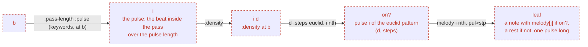
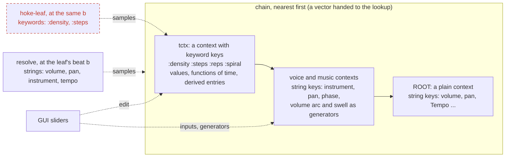
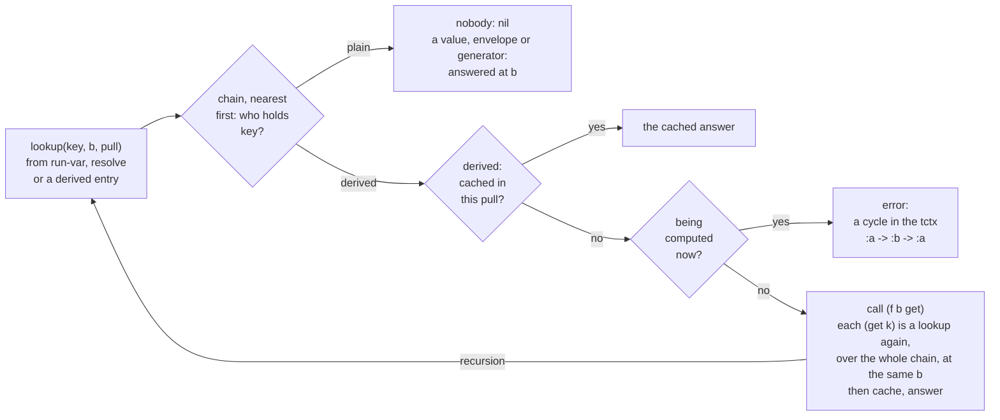

# A dynamic hoketus: call order and where the parts sit

A plan for a piece whose structure is not precompiled: the data is static, the
derivation and the actualisation are dynamic, and a GUI can change what the
music does while it plays. **A leaf has one beat, and every lookup made for it,
producing or resolving, is made at that beat** (the mechanism is in
`pull-voice.md`). Solid boxes exist today; **dashed red boxes are planned**.

## Who calls whom, for one voice and one leaf

```mermaid
flowchart LR
  engine["engine sender thread<br/>reads the voice ~100 ms ahead of the clock"]
  events["musics.events<br/>the voice's state holds :beat b"]
  source["source fn (b)<br/>one leaf"]
  word["mu word hoke-leaf<br/>run-var, lookup bound at b"]
  leaf["leaf: pitch or rest, duration<br/>no volume, no pan"]
  resolve["musics.domain.resolve<br/>resolve-event(leaf, b)"]
  chain["context chain, nearest first<br/>sample-many, at b"]
  midi["MIDI event → engine queue → note-on / note-off"]

  engine --> events
  events -- "b" --> source --> word --> leaf
  leaf --> resolve
  events -- "b" --> resolve
  resolve --> chain --> midi

  classDef planned stroke-dasharray: 5 4,stroke:#c0392b,color:#c0392b
  class source,word,leaf planned
```

## The word `hoke-leaf`: parameters on the stack

Read top to bottom; the stack is shown after each step. The voice's own inputs
(`threshold`, `phase`, `instrument`, `side`) are held by the voice and changed
by the GUI. The only thing the word is given is the beat `b`; the rest it asks
the lookup for, at `b`.

Which pulses sound is decided here, by the algorithm and the bridge: `pul>stp`
keeps a leaf for every pulse, a rest for a 0 (every voice has the same leaves at
the same beats, so the voices stay in step). Nothing in `resolve` or the engine
gates a note.

## The context chain and its readers

The chain is as it always was: contexts are beads, there is no parent pointer,
and a lookup walks the vector it is handed, nearest first. Nothing about `ROOT`
changed. What changed is the type of a key: **a string is a context key, a
keyword is a tctx key**, with no `(name key)` normalization (`ctx-append`
refuses a keyword, `tctx-put` refuses a string). The two never meet, so the tctx
can stand first in the chain without hiding any context value, and `"density"`
(a context's) and `:density` (a tctx's) are two keys.

A tctx is an ordinary `Context` whose keys are keywords. Its values are bare
numbers, functions of structural time (`tctx-put`), or entries computed from
other keys (`tctx-derive`: `(f time get)`, one pull computing a key once and a
cycle an error). Whoever builds a chain puts it in front (`[tctx voice … ROOT]`);
it is shared by atom, so a slider that edits it is seen by every voice holding
the chain at the next leaf.

A generator is a pure function of structural time, local to the context that
holds it (`generator`, `ctx-generate`). Anything on the musical keys that must
vary in time, the volume arc and the swell, sits as a generator in an ordinary
context nearer than `ROOT` (the voice's or the piece's), where what the music
itself writes still wins.

## Inside one lookup: it is recursive

A lookup is not one step. A plain entry (a value, an envelope, a generator) is
answered at once, but a **derived** entry is a function that asks the chain for
other keys, at the same beat, and those may be derived in turn. The recursion
runs over the whole chain, so a tctx entry can read a context's string key too.

- **One beat.** The recursion never changes `b`: every `get` is asked at the beat
  of the lookup that started it.
- **Cycle guard.** The keys being computed are kept on a list; asking for one of
  them again is an error naming the cycle, not a hang.
- **Cache.** A key computed once during one pull is not computed again in it. A
  pull today is one top-level lookup, so `:density` and `:steps` asked separately
  by `run-var` each start a fresh cache. A pull per leaf, shared by every lookup
  made for that leaf (one `getter` for the chain and the beat), is not built yet.
- **Depth.** Nothing limits it but the cycle guard; a deep graph costs one call
  per entry, for every leaf.

## Where each thing sits

| Layer | Holds | Changes when |
|---|---|---|
| declaration (static data) | the melody, the voice table, the drums | never while playing |
| inputs of a word voice | threshold, phase, instrument, side | a slider moves; heard at the next leaf |
| tctx, first in the chain | `:steps`, `:reps`, `:spiral`, `:density` as values, functions of time or derived entries | the GUI edits them; read at each leaf's beat |
| voice or piece context | volume arc and swell as generators, pan, instrument | the GUI edits the numbers inside them; read by `resolve` at each leaf's beat |
| the word `hoke-leaf` | which pulse sounds, and its pitch | computed again for every leaf, from the beat |
| resolve | volume, pan, instrument from the chain | on every leaf |

## Order of building

1. Built: string keys for contexts and keyword keys for a tctx (`tctx-put`),
   generators, derived entries (`tctx-derive`), the keyword-argument rule in
   `run-var` (`*lookup*`, `with-lookup`).
2. A voice as a function of beat in `musics.events` (see `pull-voice.md`): one
   leaf per call, the lookup bound at the walk's `:beat`.
3. Where the tctx lives, and the chain a voice holds with the tctx in front; a
   start word fills it and places the volume generators in a piece context.
4. The word `hoke-leaf` and a new hoketus file.
