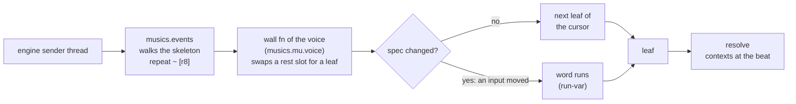
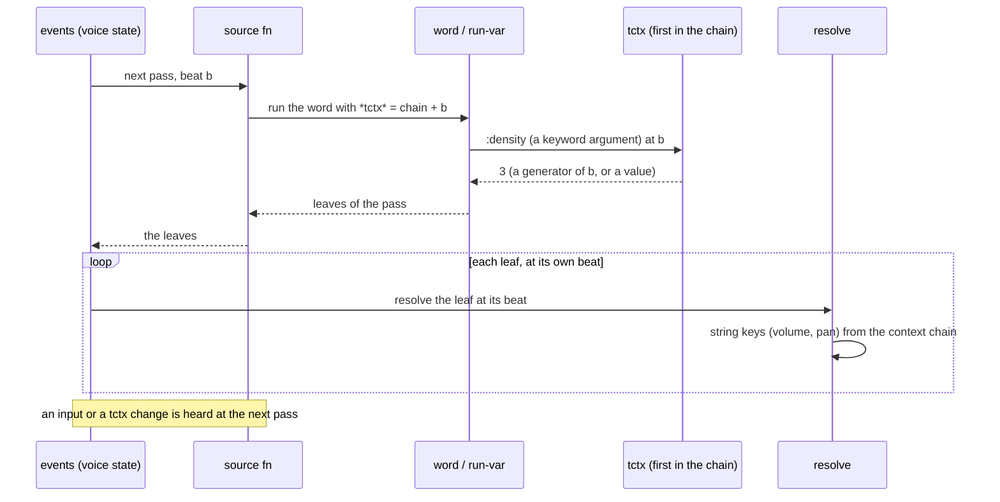

# The pull voice: a voice fed by a source function

A plan, not built. A live word voice today plays a skeleton of rests and a wall
function swaps each rest for the next leaf of what the word produced. A pull
voice drops that trick: `musics.events` is told "this voice is fed by a source
function", asks the source for the next pass at its current beat, and plays what
comes back. Solid boxes exist today; **dashed red boxes are planned**.

## Today: a skeleton and a wall function

The word runs when an input changes, not when a pass is due. It knows nothing of
time; the cursor counts leaves.

## Proposed: events asks a source at its beat

```mermaid
flowchart LR
  engine["engine sender thread"]
  events["musics.events<br/>a voice with a source<br/>holds :beat and :t"]
  source["source fn<br/>(beat) → one pass of leaves"]
  bind["binds *tctx*<br/>the chain with the tctx in front<br/>and the pass's beat"]
  word["word runs (run-var)<br/>a keyword argument the tctx<br/>holds is its value"]
  pass["leaves of one pass"]
  fire["events fires the leaves,<br/>:beat advances"]
  resolve["resolve<br/>contexts at each leaf's beat"]
  midi["MIDI event"]

  engine --> events
  events -- "pass used up:<br/>ask at the beat" --> source --> bind --> word --> pass --> fire
  fire -- "next pass" --> events
  fire --> resolve --> midi

  classDef planned stroke-dasharray: 5 4,stroke:#c0392b,color:#c0392b
  class source,bind,pass planned
```

There is no skeleton, no wall function, no cursor and no registry entry for such
a voice. Time arrives because `events` already holds `:beat`.

## Time, call by call

Two granularities: **production** reads the tctx once per pass, at the pass's
beat (the density arc, `reps`); **actualisation** reads the contexts once per
leaf, at its own beat (volume, swell, pan).

## What goes, what stays

| Part | Fate |
|---|---|
| the skeleton `repeat ~ [r8]` of a word voice | goes |
| the wall fn and cursor of `musics.mu.voice` for a word voice | go |
| the registry entry of such a voice | goes |
| a voice's inputs (`:bass/onsets`, the GUI's sliders) | stay; read when the next pass is asked for |
| the tctx and the `*tctx*` binding | new; planned |
| `:algo` tags, `assign-algo!`, the GUI's Wall window | stay until audited: they lean on the registry |

## Open questions

- **Can events walk the source?** `walk-forms` consumes a form lazily, but a helper
  it calls (`peel-group-contexts`) may force a whole sequence. Not checked.
- **The shape of the form.** A `{:source f}` map or a small record `Source`; one
  more case in `walk-form`, and a way to start such a voice (`engine/start-voice!`).
- **Whose zero.** A voice counts `:beat` from its own start; a voice joined later
  is off by its start. One shared clock for a performance would need the engine's.
- **A pass's beat in a hocket.** The B group starts late. Sampling at the pass's
  nominal time (pass number × pass length) keeps both groups at one density.
- **Where the GUI lists voices.** The Wall window reads the registry today.
