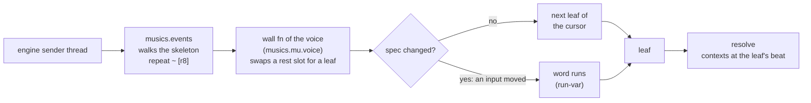
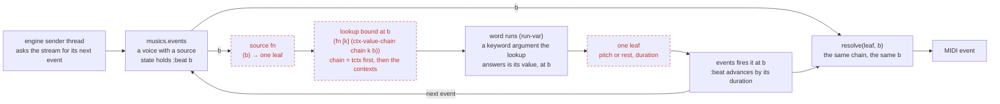
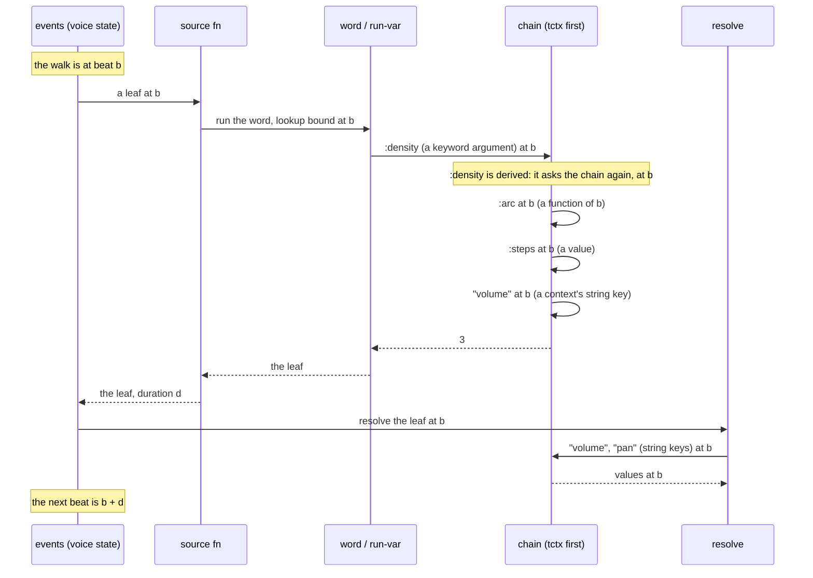

# A voice as a function of beat

Built (`musics.compose/source`, `musics.events/walk-source`, `mus/hoketus2.mus`); the diagrams below were drawn before it was and still mark it as planned. **A leaf has one beat, and every lookup made for it, whether
while producing it or while resolving it, is made at that beat.** A live voice
today plays a skeleton of rests and a wall function swaps each rest for the next
leaf of a pass the word produced earlier. A voice as a function of beat drops
that: `musics.events` is told "this voice is fed by a source function", asks the
source for **one leaf at the beat it is at**, and plays what comes back. The
source and `resolve` get the same `:beat`, so they cannot disagree about time.
Solid boxes exist today; **dashed red boxes are planned**.

## Today: a skeleton and a wall function

The word runs when an input changes, at no beat at all; the cursor counts leaves.
What the word read, it read once for the whole material.

## Proposed: one leaf, one beat

There is no skeleton, no wall function, no cursor, no pass and no registry entry
for such a voice. The beat comes from the one place that already holds it, the
walk's state, and it goes to both the source and `resolve`.

## One leaf, call by call

A lookup can be recursive: a derived entry asks the chain for other keys, at the
same beat, and they may be derived in turn (see `hoketus-dynamic.md`, "Inside one
lookup"). The recursion stays inside the one beat.

## The contract

- **One beat per leaf.** The walk's `:beat` is the leaf's beat. The source gets it
  as its argument; `resolve` gets it as it does today.
- **Every lookup for the leaf is at that beat,** the tctx's keyword keys read
  while the leaf is produced and the contexts' string keys read while it is
  resolved. `with-lookup` is bound at that beat for each call of the source.
- **The source is a pure function of the beat and the tctx,** and so is every
  entry the lookup reaches, however deeply it recurses. The same beat gives the
  same leaf, so a re-read or a rewind agrees with what was heard.
- **A leaf may be of any length.** Its duration moves the beat on, so the source
  needs no grid: a pulse number is derived from the beat (the beat inside the
  pass, over the pulse length, both tctx keys).
- **A batch is allowed only as an optimisation,** and only if it computes each of
  its leaves at that leaf's own beat. A batch that reads the tctx once at its
  start breaks the rule.

## What it changes

| | A pass per call (the first plan) | One leaf per call |
|---|---|---|
| production reads the tctx | once per pass, at the pass's start | once per leaf, at its own beat |
| `resolve` reads the contexts | once per leaf, at its beat | the same |
| the two beats | can differ | are the same beat |
| a change heard | within a pass, 1–4 s | within the lookahead, about 100 ms |
| word runs | once per pass | once per leaf |

## What goes, what stays

| Part | Fate |
|---|---|
| the skeleton `repeat ~ [r8]` of a word voice | goes |
| the wall fn and cursor of `musics.mu.voice` for a word voice | go |
| the registry entry of such a voice | goes |
| the idea of a pass as a unit of production | goes |
| a voice's inputs (`:bass/onsets`, the GUI's sliders) | stay; read at the next leaf |
| the tctx, `*lookup*` and `with-lookup`, derived entries | built; the voice binds them |
| `:algo` tags, `assign-algo!`, the GUI's Wall window | stay until audited: they lean on the registry |

## Open questions

- **Can events walk the source one leaf at a time?** `walk-forms` consumes a form
  lazily, but a helper it calls (`peel-group-contexts`) may force a whole
  sequence. Not checked.
- **The shape of the form.** A `{:source f}` map or a small record `Source`; one
  more case in `walk-form`, and a way to start such a voice (`engine/start-voice!`).
- **Cost.** The word runs once per leaf (8 or 16 times per pass of hoketus). The
  algorithms involved are small; to be measured, not assumed.
- **Whose zero.** A voice counts `:beat` from its own start; a voice joined later
  is off by its start. One shared clock for a performance would need the engine's.
- **A hocket's late group.** The B group's leaves have beats later by the lag, and
  so read the tctx later by the lag. That is the rule working: each leaf is timed
  by its own beat.
- **Where the GUI lists voices.** The Wall window reads the registry today.
